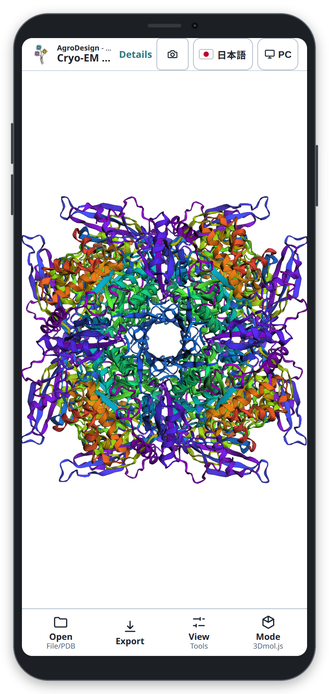
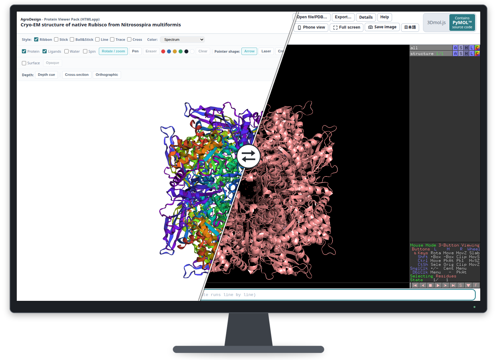

# AgroDesign Protein Viewer Pack (HTMLapp)

タンパク質の立体構造を見る、**HTML ファイル 1 つ**のアプリです。Powered by 3Dmol.js. Contains PyMOL™ source code.

- **HTML ファイル 1 つで動く** — ダブルクリックするだけ。インストールもアカウントも不要で、オフラインでも動きます。
- **スマホでも PC でも** — 同じファイルが Windows・macOS・Linux・iPhone / iPad（iOS / iPadOS）・Android™ のブラウザで動きます。
- **メールで構造を送れる** — 構造を入れたままアプリを保存してメールに添付すれば、受け取った人はダブルクリックですぐに構造を見られます。インストールも、構造生物学の専門知識も要りません。

スマホで見たサンプル 25HN。左: 3Dmol.js、右: フル版の高機能ビューア（Built using PyMOL™.）

PC でも。左: 3Dmol.js、右: 高機能ビューア（Built using PyMOL™.）。ワンタッチで切り替えられます。

*English follows below.*

## ダウンロード

[Releases](https://github.com/AgroDesign-Studios/ProteinViewerPack/releases/latest) からどちらか 1 つをダウンロードし、ダブルクリックで開きます。

| ファイル | 大きさ | 中身 |
|---|---|---|
| `AgroDesign-ProteinViewerPack-v<版>_full_<日付>.html`（フル版） | 約 21 MB | 3Dmol.js と高機能ビューア（Contains PyMOL™ source code.）: メニュー・コマンドライン・レイトレース画像・.pse セッション |
| `AgroDesign-ProteinViewerPack-v<版>_light_<日付>.html`（ライト版） | 約 1.2 MB | 3Dmol.js のみ |

ダウンロードしたファイルは空です。「ファイル/PDBを開く…」で構造ファイル（PDB・mmCIF・SDF/MOL・MOL2・XYZ、フル版は .pse も）を開くか、PDB ID を入れるか、ファイルをページにドロップします。

**サンプル**: [`index.html`](index.html)（日本語）と [`en/index.html`](en/index.html)（英語）は、PDB エントリ [25HN](https://www.rcsb.org/structure/25HN) を入れたフル版です。「Download raw file」でダウンロードしてダブルクリックすると開きます。構造ファイルだけなら [`sample/25HN.cif`](sample/25HN.cif)。

## メールで構造を送る

1. 構造を開く
2. 「エクスポート…」→「HTMLappとして出力（このアプリをコピー）」で、「版」（「ライト版」か、フル版にあたる「通常版」）を選んで保存
3. 保存した .html をメールに添付

メールの添付は 20〜25 MB 程度までのことが多く、フル版（約 21 MB＋構造）は届かないことがあります。メールにはライト版（約 1.2 MB＋構造）を使うか、フル版はファイル共有サービスで渡してください。

## 使い方

- **回す・拡大・移動**: マウスは左ドラッグ・右ドラッグ・中ドラッグ。タッチは 1 本指・ピンチ・2 本指。
- **ビューアの切り替え（フル版）**: 右上の切り替え（スマホは下部バーの「エンジン」）。高機能ビューアは起動に時間がかかり、メモリを 0.5〜1.5 GB 使います。
- **スマホ表示**: 幅の狭い画面では 1 画面に収まる表示になり、下部バーで操作します。上部の「スマホ表示」／「PC」で切り替えられます。
- **言語**: 日本語で開きます。上部の「English」／「日本語」で切り替えます。
- **HELP**: 「このアプリについて」「使い方」「最新版ダウンロード」。

## できること

- 3Dmol.js: リボン・スティック・ボール＆スティック・ライン・表面、配色、測定、ペンとレーザーポインター、奥行き強調、断面、平行投影
- フル版の高機能ビューア（Contains PyMOL™ source code.）: メニューとコマンドライン、.pse セッション、レイトレース画像
- 保存: スクリーンショット（PNG）、レイトレース画像、構造ファイル、選択範囲の分子ファイル、.pse、VRML（.wrl）、HTMLapp
- 開いたファイルはどこにも送りません。ネットにつなぐのは、PDB から読むとき（files.rcsb.org）、「GitHub の最新版と比べる」を押したとき（api.github.com）、外へのリンクを開いたときだけです。

## PC での表示

 

## 動作環境

| ブラウザ | 3Dmol.js（両方の版） | 高機能ビューア（フル版） |
|---|---|---|
| Chrome・Edge（Windows・macOS・Linux・Android） | 111 以降 | 111 以降 |
| Firefox（Windows・macOS・Linux・Android） | 121 以降 | 121 以降 |
| Safari（macOS） | 16.4 以降 | 17 以降 |
| iPhone・iPad のブラウザ（Safari・Edge・Chrome など。どれも WebKit） | iOS / iPadOS 16.4 以降 | iOS / iPadOS 17 以降 |

- **実機で確認済み**: Windows の Chrome、iPhone の Edge
- **自動検証のみ**: Linux の Chrome（headless・ソフトウェア描画で両方のビューアを確認）
- **要件上は動くはず（未確認）**: Android（Chrome・Firefox など）、macOS（Safari・Chrome など）、Windows の Edge・Firefox、iPhone の Safari、iPad
- 高機能ビューアが使えないブラウザやメモリの少ないスマホでは 3Dmol.js で表示します。WebGL がないブラウザでは、鎖とリガンドの一覧を文字で表示します。

## ライセンス・帰属・商標

- このアプリ自体は [MIT License](LICENSE)。同梱のオープンソースソフトウェアはそれぞれのライセンスに従い、名前・版・全文は [`NOTICE`](NOTICE) とアプリの「HELP」→「このアプリについて」にあります。
- Contains PyMOL™ source code.（PyMOL™ のソースコードを含みます。）フル版の高機能ビューアは、AgroDesign Studios が Open-Source PyMOL のソースコードをそのライセンスのもとで変更・機能追加し、WebAssembly でブラウザ向けにビルドしたものです。Schrödinger, LLC が配布する PyMOL 製品とは別のものです。
- Powered by 3Dmol.js（BSD 3-Clause License）。論文: Nicholas Rego and David Koes, "3Dmol.js: molecular visualization with WebGL", *Bioinformatics* 31(8):1322–1324 (2015), [doi:10.1093/bioinformatics/btu829](https://doi.org/10.1093/bioinformatics/btu829)
- サンプルは RCSB PDB のエントリ 25HN（[DOI 10.2210/pdb25HN/pdb](https://doi.org/10.2210/pdb25HN/pdb)）。PDB のデータは CC0 1.0 です。
- バッジとスマホ・モニターの絵（[`images/`](images)）:
  - Android のロボットは Google の作品を複製・改変したもので、CC BY 3.0 の条件に従って使用しています（原文: "The Android robot is reproduced or modified from work created and shared by Google and used according to terms described in the [Creative Commons](https://creativecommons.org/licenses/by/3.0/) 3.0 Attribution License."）。
  - Linux のペンギン（Tux）は Larry Ewing（lewing@isc.tamu.edu）が The GIMP で描いたもので、[Simple Icons](https://simpleicons.org/) の図形（CC0 1.0）を使っています。
  - iOS / iPadOS のバッジの電話の絵と、スクリーンショットを囲むスマホとモニターの絵は、このリポジトリで描いたもので、特定の製品を表すものではありません。ほかの OS とブラウザは名前だけで示しています。
- 商標: Android と Chrome は Google LLC の商標です。iPhone、iPad、iPadOS、macOS、Safari は、米国およびその他の国や地域で登録された Apple Inc. の商標です。IOS は Cisco の米国およびその他の国における商標または登録商標で、ライセンスに基づき使用されています。Microsoft、Microsoft Edge、Windows は Microsoft グループ各社の商標です。Linux® は Linus Torvalds の米国およびその他の国における登録商標です。Firefox は Mozilla Foundation の米国およびその他の国における商標です。このアプリはこれらの会社・団体（Mozilla を含む）と公式な関係はなく、名前は動作する環境を示すためだけに使っています。
- 製作: 株式会社アグロデザイン・スタジオ（AgroDesign Studios）、西ヶ谷有輝（NISHIGAYA Yuki）。Copyright (c) 2026 AgroDesign Studios
- PyMOL は Schrödinger, LLC の商標です（原文はこの README の末尾）。

---

# AgroDesign Protein Viewer Pack (HTMLapp) (English)

A protein structure viewer in **one HTML file**. Powered by 3Dmol.js. Contains PyMOL™ source code.

- **One HTML file** — double-click it and it opens in your browser. Nothing to install, no account, works offline.
- **On phones and PCs** — the same file runs in the browser on Windows, macOS, Linux, iPhone / iPad (iOS / iPadOS) and Android™.
- **Send a structure by e-mail** — save the app with your structure inside and attach it. The recipient double-clicks it and sees the structure at once: no install, no structural-biology expertise.

The sample 25HN on a phone. Left: 3Dmol.js. Right: the full edition's advanced viewer (Built using PyMOL™.)

On a PC too. Left: 3Dmol.js. Right: the advanced viewer (Built using PyMOL™.) One click switches between them.

## Download

From [Releases](https://github.com/AgroDesign-Studios/ProteinViewerPack/releases/latest), download one file and double-click it.

| File | Size | Contents |
|---|---|---|
| `AgroDesign-ProteinViewerPack-v<version>_full_<date>.html` (full edition) | about 21 MB | 3Dmol.js and an advanced viewer (Contains PyMOL™ source code.): menus, command line, ray-traced images, .pse sessions |
| `AgroDesign-ProteinViewerPack-v<version>_light_<date>.html` (light edition) | about 1.2 MB | 3Dmol.js only |

The downloaded files are empty. Open a structure file with "Open file/PDB…" (PDB, mmCIF, SDF/MOL, MOL2, XYZ; .pse in the full edition), enter a PDB ID, or drop a file on the page.

**Sample**: [`index.html`](index.html) (Japanese) and [`en/index.html`](en/index.html) (English) are the full edition with PDB entry [25HN](https://www.rcsb.org/structure/25HN) inside. Download one ("Download raw file") and double-click it. The structure file alone: [`sample/25HN.cif`](sample/25HN.cif).

## Sending a structure by e-mail

1. Open the structure
2. "Export…" → "Save as HTMLapp (a copy of this app)", choose the edition and save
3. Attach the saved .html to an e-mail

Mail services often cap attachments at about 20-25 MB, so the full edition (about 21 MB plus the structure) may not get through. Send the light edition (about 1.2 MB plus the structure), or share the full edition through a file-sharing service.

## How to use

- **Turn, zoom, move**: mouse left, right and middle drag; on a touch screen one finger, pinch and two fingers.
- **Switch viewer (full edition)**: the control at the top right (on a phone, "Engine" in the bottom bar). The advanced viewer takes a while to start and uses 0.5-1.5 GB of memory.
- **Phone layout**: a narrow screen gets a one-screen layout with a bottom bar. "Phone view" / "PC" at the top switches.
- **Language**: opens in Japanese; "English" / "日本語" at the top switches.
- **Help**: "About this app", "How to use", "Latest version".

## Features

- 3Dmol.js: ribbon, stick, ball and stick, line, surface; colouring; measuring; pen and laser pointer; depth cueing, slicing, orthographic view
- The full edition's advanced viewer (Contains PyMOL™ source code.): menus and command line, .pse sessions, ray-traced images
- Save: screenshots (PNG), ray-traced images, structure files, molecule files of a selection, .pse, VRML (.wrl), HTMLapp
- The files you open are sent nowhere. The app goes online only to load from the PDB (files.rcsb.org), when you press "Compare with the latest on GitHub" (api.github.com), or when you follow a link out of the file.

## On a PC

 

## Supported environments

| Browser | 3Dmol.js (both editions) | Advanced viewer (full edition) |
|---|---|---|
| Chrome, Edge (Windows, macOS, Linux, Android) | 111 or later | 111 or later |
| Firefox (Windows, macOS, Linux, Android) | 121 or later | 121 or later |
| Safari (macOS) | 16.4 or later | 17 or later |
| Browsers on an iPhone or iPad (Safari, Edge, Chrome and others, all WebKit) | iOS / iPadOS 16.4 or later | iOS / iPadOS 17 or later |

- **Tried on real devices**: Chrome on Windows, Edge on an iPhone
- **Automated check only**: Chrome on Linux (headless, software rendering, both viewers)
- **Should work from the requirements (not yet tried)**: Android (Chrome, Firefox and others), macOS (Safari, Chrome and others), Edge and Firefox on Windows, Safari on an iPhone, an iPad
- Where the advanced viewer cannot run (an older browser, a phone short of memory), 3Dmol.js shows the structure. Without WebGL, the app lists the chains and ligands in words.

## License, attribution and trademarks

- This app is under the [MIT License](LICENSE). The open-source software it carries keeps its own licence; names, versions and full texts are in [`NOTICE`](NOTICE) and in the app under "Help" → "About this app".
- Contains PyMOL™ source code. The full edition's advanced viewer is built from Open-Source PyMOL source code, which AgroDesign Studios modified and extended under its license and compiled for the browser with WebAssembly. It is distinct from the PyMOL products distributed by Schrödinger, LLC.
- Powered by 3Dmol.js (BSD 3-Clause License). Please cite: Nicholas Rego and David Koes, "3Dmol.js: molecular visualization with WebGL", *Bioinformatics* 31(8):1322-1324 (2015), [doi:10.1093/bioinformatics/btu829](https://doi.org/10.1093/bioinformatics/btu829)
- The sample is PDB entry 25HN from the RCSB PDB ([DOI 10.2210/pdb25HN/pdb](https://doi.org/10.2210/pdb25HN/pdb)). PDB data are CC0 1.0.
- Badges, phone and monitor pictures ([`images/`](images)):
  - The Android robot is reproduced or modified from work created and shared by Google and used according to terms described in the [Creative Commons](https://creativecommons.org/licenses/by/3.0/) 3.0 Attribution License.
  - Tux, the Linux penguin, was drawn by Larry Ewing (lewing@isc.tamu.edu) with The GIMP; the shape used is from [Simple Icons](https://simpleicons.org/) (CC0 1.0).
  - The phone outline on the iOS / iPadOS badge and the phone and the monitor around the screenshots were drawn for this repository and depict no particular product. The other systems and the browsers are shown by name only.
- Trademarks: Android and Chrome are trademarks of Google LLC. iPhone, iPad, iPadOS, macOS and Safari are trademarks of Apple Inc., registered in the U.S. and other countries and regions. IOS is a trademark or registered trademark of Cisco in the U.S. and other countries and is used under license. Microsoft, Microsoft Edge and Windows are trademarks of the Microsoft group of companies. Linux® is the registered trademark of Linus Torvalds in the U.S. and other countries. Firefox is a trademark of the Mozilla Foundation in the U.S. and other countries. This app is not officially associated with any of these companies or organisations, Mozilla included; the names are used only to say where the app runs.
- Made by AgroDesign Studios, Inc. (NISHIGAYA Yuki). Copyright (c) 2026 AgroDesign Studios
- The PyMOL trademark notice is at the end of this README.

---

## 更新履歴

各バージョンの主な変更です。ダウンロードは [Releases](https://github.com/AgroDesign-Studios/ProteinViewerPack/releases) から。

### v1.0.0（2026-11-16）
- 最初の版です。

---

## Release notes

The main changes in each version. Downloads are on the [Releases](https://github.com/AgroDesign-Studios/ProteinViewerPack/releases) page.

### v1.0.0 (2026-11-16)
- First version.

---

PyMOL is a trademark of Schrodinger, LLC.
