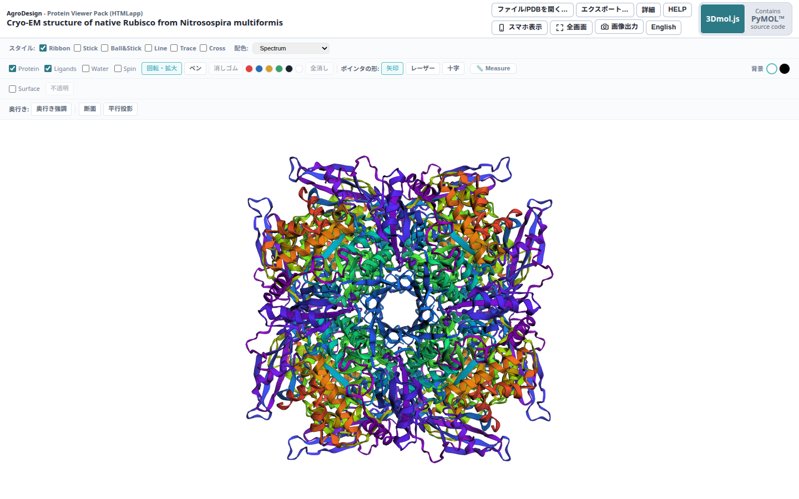
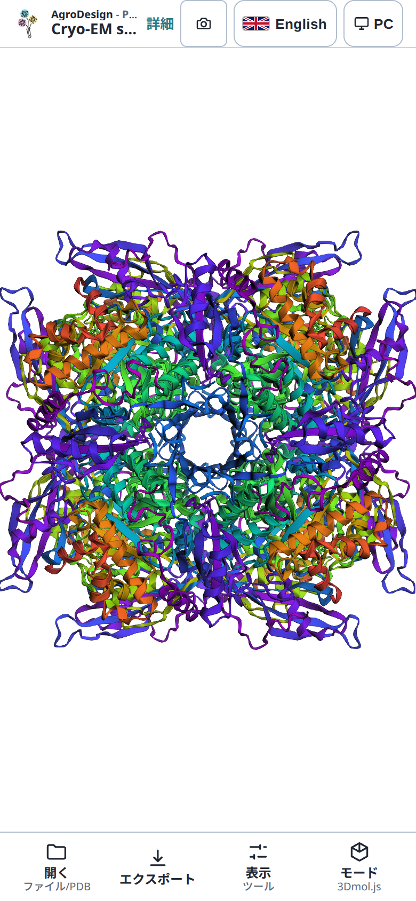
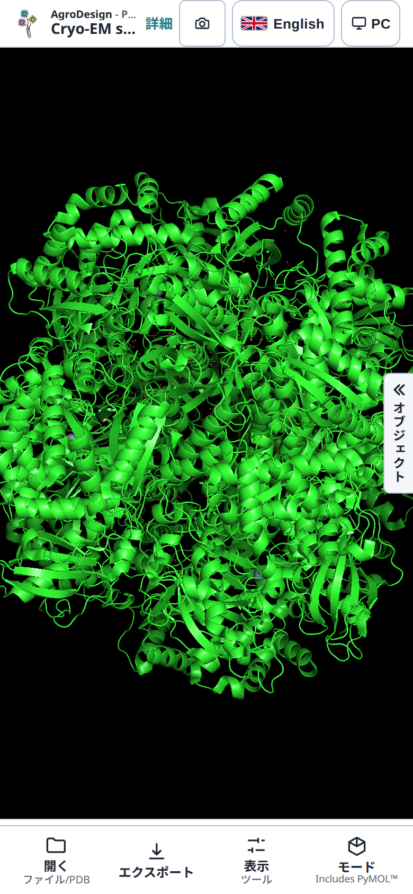
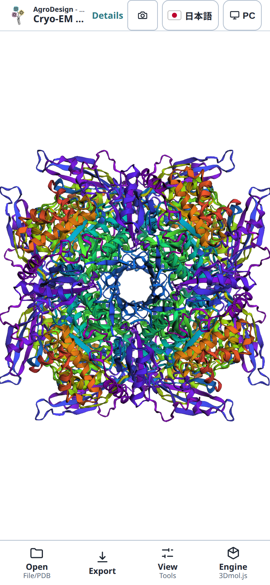
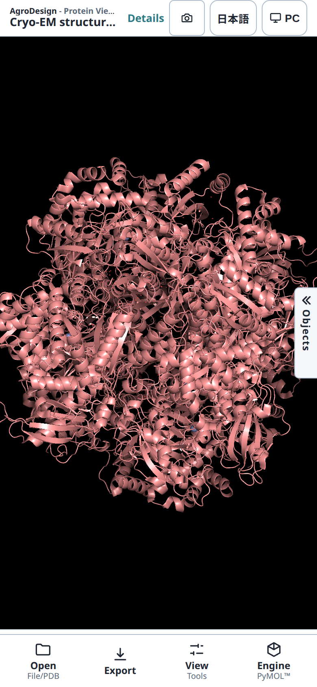

# AgroDesign Protein Viewer Pack (HTMLapp)

**スマホでも使えます。** Android™ のスマホ・タブレットと iPhone・iPad のブラウザで、PC（Windows・macOS・Linux）と同じ 1 つのファイルがそのまま動きます。幅の狭い画面では、1 画面に収まるスマホ表示になります。

**ブラウザ**: Chrome 111 以降・Edge 111 以降・Firefox 121 以降・Safari 16.4 以降（フル版の PyMOL は Safari 17 以降）。実機で確かめた組み合わせと、要件上は動くはずの組み合わせは「[動作環境](#動作環境)」に分けて書いています。

ブラウザだけで動くタンパク質立体構造ビューアです。PyMOL（WebAssembly でブラウザ向けにビルドしたもの）と 3Dmol.js を HTML ファイル 1 個に収めています。インストールもアカウント登録も不要で、オフラインでも動きます。PC でもスマホでも使えます。

*English follows below.*

## サンプル

このリポジトリの [`index.html`](index.html)（日本語）と [`en/index.html`](en/index.html)（英語）は、サンプルの構造を埋め込んだフル版のアプリです。サンプルは PDB ID [25HN](https://www.rcsb.org/structure/25HN)「Cryo-EM structure of native Rubisco from Nitrosospira multiformis」（Nitrosospira multiformis 由来の天然 Rubisco のクライオ電子顕微鏡構造）です。ファイルのページの「Download raw file」ボタンでダウンロードしてダブルクリックすると、25HN が表示されます。構造ファイルだけのものは [`sample/25HN.cif`](sample/25HN.cif) にあり、アプリの「ファイル/PDBを開く…」で開けます。

## 使い方（ダウンロード方法）

- **最新版をダウンロード**: [Releases](https://github.com/AgroDesign-Studios/ProteinViewerPack/releases/latest) から次の 2 つのどちらかをダウンロードし、ダブルクリックして開きます。ダウンロードしたファイルに構造は入っていません。
  - フル版 `AgroDesign-ProteinViewerPack-v<バージョン>_full_<日付>.html`（約 21 MB）: 3Dmol.js と PyMOL
  - ライト版 `AgroDesign-ProteinViewerPack-v<バージョン>_light_<日付>.html`（約 1.2 MB）: 3Dmol.js のみ
- **構造を開く**: 上部の「ファイル/PDBを開く…」から、このコンピュータの構造ファイル（PDB・mmCIF・SDF/MOL・MOL2・XYZ、フル版では PyMOL セッション .pse も）を開くか、PDB ID（例: 25HN）を入れて PDB からダウンロードします。ファイルをページのどこかにドロップしても開けます。
- **回す・拡大する**: マウスでは、左ボタンのドラッグで回転、右ボタンで拡大・縮小、中ボタンで移動します。タッチ画面では、1 本指で回転、ピンチで拡大・縮小、2 本指で移動します。
- **2 つの描画エンジン**: 3Dmol.js は軽く、すぐに表示できます。PyMOL はメニューやコマンドライン、レイトレース画像など多くのことができますが重く、起動に時間がかかり、メモリを 0.5〜1.5 GB 使います。右上の切り替え（スマホでは下部バーの「エンジン」）で選びます。
- **スマホで使う**: 幅の狭い画面ではスマホ向けの表示になり、下部バーから操作します。上部の「スマホ表示」／「PC」ボタンで 2 つの表示を切り替えられます。
- **言語**: ファイルは日本語で開きます。上部の「English」／「日本語」ボタンで表示言語を切り替えられます。
- **HELP**: 上部の「HELP」に「このアプリについて」「使い方」「最新版ダウンロード」のタブがあります。

## 動作環境

アプリに必要なもの（3Dmol.js の WebGL、PyMOL の WebAssembly・WebGL2・ワーカーでの OffscreenCanvas、アプリ自体が使う JavaScript と CSS）から決めた、必要なブラウザの版です。

| ブラウザ | ライト版・フル版の 3Dmol.js | フル版の PyMOL |
|---|---|---|
| Chrome・Edge（Windows・macOS・Linux・Android） | 111 以降 | 111 以降 |
| Firefox（Windows・macOS・Linux・Android） | 121 以降 | 121 以降 |
| Safari（macOS） | 16.4 以降 | 17 以降 |
| iPhone・iPad のブラウザ（Safari・Edge・Chrome など。どれも Safari と同じ WebKit で動きます） | iOS / iPadOS 16.4 以降 | iOS / iPadOS 17 以降 |

- **実機で確認済み**: Windows の Chrome、iPhone の Edge（作者が実機で確認）。Linux の Chrome（headless 版・ソフトウェア描画での自動検証で、3Dmol.js と PyMOL の両方でサンプルを表示）
- **要件上は動くはず（未確認）**: Android（Chrome・Firefox など）、macOS（Safari・Chrome など）、Windows の Edge・Firefox、iPhone の Safari、iPad
- PyMOL は起動に時間がかかり、メモリを 0.5〜1.5 GB 使います。メモリの少ないスマホでは、ブラウザの版が足りていても PyMOL が起動できないことがあります。そのときも 3Dmol.js で表示できます。
- PyMOL に必要な機能がないブラウザ（例: iOS 17 より前の iPhone・iPad）では、3Dmol.js だけで構造を表示します。WebGL が使えないブラウザでは、構造の代わりに鎖とリガンドの一覧を文字で表示します。

## できること

- 3Dmol.js での表示: スタイル（リボン・スティック・ボール＆スティック・ライン・表面）、配色、リガンドと水の表示、距離などの測定、説明用のペンとレーザーポインター、奥行き強調、断面、平行投影
- PyMOL（フル版）: メニューとコマンドライン、PyMOL セッション（.pse）、レイトレース画像
- 保存: スクリーンショット（PNG）、PyMOL のレイトレース画像、構造ファイル、選択範囲の分子ファイル、PyMOL セッション（.pse）、3Dmol.js セッション（VRML .wrl）
- 「HTMLappとして出力」: いま開いている構造を入れて（または空のまま）、このアプリ全体を HTML ファイル 1 つにコピーします。メールで送れば、相手はインストールなしで開けます。
- オフラインで動く: すべてこの 1 つのファイルの中で動き、開いたファイルはどこにも送信しません。インターネットに接続するのは、PDB から読み込むとき（files.rcsb.org）、「GitHub の最新版と比べる」を押したとき（api.github.com）、ファイルの外へのリンクを開いたときだけです。

## スクリーンショット

サンプルの 25HN を PC で表示したところ（左: 3Dmol.js、右: PyMOL）:

 

スマホで表示したところ（左: 3Dmol.js、右: PyMOL）:

 

## ライセンス

- このアプリ自体のプログラムは [MIT License](LICENSE) で公開しています。
- HTML ファイルに含まれるオープンソースソフトウェア（3Dmol.js とその同梱コード、PyMOL とその実行環境（Pyodide・CPython・NumPy など）、React・i18next など）は、それぞれのライセンスに従います。各ソフトウェアの名前・版・ライセンス全文は [`NOTICE`](NOTICE) と、アプリの「HELP」→「このアプリについて」に載っています。
- 本アプリは、Open-Source PyMOL のソースコードをオープンソースライセンスのもとで利用し、AgroDesign Studios が開発（変更・機能追加）したアプリです。PyMOL™ は Schrödinger, LLC の商標です。
- サンプルデータは RCSB Protein Data Bank の PDB エントリ 25HN です（<https://files.rcsb.org/download/25HN.cif>、DOI [10.2210/pdb25HN/pdb](https://doi.org/10.2210/pdb25HN/pdb)）。PDB のデータには著作権上の制限がありません（CC0 1.0）。
- 先頭の動作環境のバッジ（[`images/badges/`](images/badges)）について:
  - Android のロボットは、Google が作成・共有した作品を複製または改変したもので、クリエイティブ・コモンズ 表示 3.0 ライセンスの条件に従って使用しています（原文: "The Android robot is reproduced or modified from work created and shared by Google and used according to terms described in the [Creative Commons](https://creativecommons.org/licenses/by/3.0/) 3.0 Attribution License."）。
  - Linux のペンギン（Tux）は Larry Ewing（lewing@isc.tamu.edu）が The GIMP で描いたもので、[Simple Icons](https://simpleicons.org/) の図形（CC0 1.0）を使っています。
  - iOS / iPadOS のバッジの電話の絵は、このリポジトリで描いたものです。ほかの OS とブラウザは、各社のロゴを使わず名前だけで示しています。
- 商標: Android と Chrome は Google LLC の商標です。iPhone、iPad、iPadOS、macOS、Safari は、米国およびその他の国や地域で登録された Apple Inc. の商標です。IOS は Cisco の米国およびその他の国における商標または登録商標で、ライセンスに基づき使用されています。Microsoft、Microsoft Edge、Windows は Microsoft グループ各社の商標です。Linux® は Linus Torvalds の米国およびその他の国における登録商標です。Firefox は Mozilla Foundation の米国およびその他の国における商標です。AgroDesign Protein Viewer Pack は、これらの会社・団体（Mozilla を含む）と公式な関係はなく、名前は動作する環境を示すためだけに使っています。

## 製作

- 製作会社: 株式会社アグロデザイン・スタジオ（AgroDesign Studios）
- 製作者: 西ヶ谷有輝（NISHIGAYA Yuki）

Copyright (c) 2026 AgroDesign Studios

---

# AgroDesign Protein Viewer Pack (HTMLapp) (English)

**Works on phones too.** The same single file runs in the browsers of Android™ phones and tablets and of iPhones and iPads, just as on a PC (Windows, macOS, Linux). On a narrow screen the app switches to a phone layout that fits one screen.

**Browsers**: Chrome 111 or later, Edge 111 or later, Firefox 121 or later, Safari 16.4 or later (Safari 17 or later for PyMOL in the full edition). Which combinations have been tried on real devices, and which should work from the requirements, are listed apart under "[Supported environments](#supported-environments)".

A protein structure viewer that runs entirely in your browser. PyMOL (built for the browser with WebAssembly) and 3Dmol.js are packed into a single HTML file: nothing to install, no account, and it works offline. It runs on PCs and on phones.

## Sample

[`index.html`](index.html) (Japanese) and [`en/index.html`](en/index.html) (English) in this repository are the full edition of the app with a sample structure embedded: PDB ID [25HN](https://www.rcsb.org/structure/25HN), "Cryo-EM structure of native Rubisco from Nitrosospira multiformis". Download one (the "Download raw file" button on its page) and double-click it, and 25HN is shown. The structure file alone is [`sample/25HN.cif`](sample/25HN.cif); open it with "Open file/PDB…" in the app.

## How to use (Download)

- **Download the latest version**: download one of the two files from [Releases](https://github.com/AgroDesign-Studios/ProteinViewerPack/releases/latest) and double-click it. The downloaded file contains no structure.
  - Full edition `AgroDesign-ProteinViewerPack-v<version>_full_<date>.html` (about 21 MB): 3Dmol.js and PyMOL
  - Light edition `AgroDesign-ProteinViewerPack-v<version>_light_<date>.html` (about 1.2 MB): 3Dmol.js only
- **Opening a structure**: "Open file/PDB…" at the top opens a structure file from your computer (PDB, mmCIF, SDF/MOL, MOL2, XYZ; in the full edition also a PyMOL session .pse), or downloads an entry from the PDB by its PDB ID (for example 25HN). You can also drop a file anywhere on the page.
- **Turning and zooming**: with a mouse, drag with the left button to turn, the right button to zoom and the middle button to move. On a touch screen, one finger turns, pinching zooms and two fingers move.
- **Two engines**: 3Dmol.js is light and starts at once. PyMOL can do much more (its menus and command line, ray-traced pictures), but it is heavy: it takes a while to start and uses 0.5-1.5 GB of memory. Switch with the control at the top right (on a phone, "Engine" in the bottom bar).
- **On a phone**: on a narrow screen the app switches to its phone layout, with the controls in the bottom bar. The "Phone view" / "PC" button at the top switches between the two layouts.
- **Language**: the file opens in Japanese; the "English" / "日本語" button at the top switches the language.
- **Help**: "Help" at the top has "About this app", "How to use" and "Latest version" tabs.

## Supported environments

The browser versions the app needs, worked out from what it uses (WebGL for 3Dmol.js; WebAssembly, WebGL2 and OffscreenCanvas in a worker for PyMOL; the JavaScript and CSS of the app itself).

| Browser | 3Dmol.js (light and full editions) | PyMOL (full edition) |
|---|---|---|
| Chrome, Edge (Windows, macOS, Linux, Android) | 111 or later | 111 or later |
| Firefox (Windows, macOS, Linux, Android) | 121 or later | 121 or later |
| Safari (macOS) | 16.4 or later | 17 or later |
| Browsers on an iPhone or iPad (Safari, Edge, Chrome and others, which all run on Safari's WebKit) | iOS / iPadOS 16.4 or later | iOS / iPadOS 17 or later |

- **Tried on real devices**: Chrome on Windows and Edge on an iPhone (by the author). Chrome on Linux (an automated check with headless Chrome and software rendering, showing the sample with both 3Dmol.js and PyMOL)
- **Should work from the requirements (not yet tried)**: Android (Chrome, Firefox and others), macOS (Safari, Chrome and others), Edge and Firefox on Windows, Safari on an iPhone, an iPad
- PyMOL takes a while to start and uses 0.5-1.5 GB of memory. On a phone with little memory it may fail to start even in a new enough browser; 3Dmol.js still shows the structure.
- In a browser without what PyMOL needs (for example an iPhone or iPad before iOS 17), the app shows structures with 3Dmol.js only. In a browser without WebGL, it lists the chains and ligands in words instead of drawing the structure.

## Features

- Viewing with 3Dmol.js: styles (ribbon, stick, ball and stick, line, surface), colouring, ligands and water, measuring, a pen and a laser pointer for presenting, depth cueing, slicing and orthographic view
- PyMOL (full edition): its menus and command line, PyMOL sessions (.pse), ray-traced pictures
- Saving: screenshots (PNG), PyMOL ray-traced pictures, the structure file, molecule files of a selection, PyMOL sessions (.pse) and 3Dmol.js sessions (VRML .wrl)
- "Save as HTMLapp": makes a copy of this whole app as one HTML file, with the structure now open in it or empty, ready to send to someone by e-mail
- Works offline: everything runs inside the one file, and the files you open are sent nowhere. It connects to the internet only to load an entry from the PDB (files.rcsb.org), when you press "Compare with the latest on GitHub" (api.github.com), or when you open a link out of the file.

## Screenshots

The sample 25HN on a PC (left: 3Dmol.js, right: PyMOL):

 

On a phone (left: 3Dmol.js, right: PyMOL):

 

## License

- This app's own program is published under the [MIT License](LICENSE).
- The open-source software the HTML files carry (3Dmol.js and what it bundles, PyMOL and its runtime (Pyodide, CPython, NumPy and others), React, i18next and others) keeps its own licence. The name, version and full licence text of each is in [`NOTICE`](NOTICE), and in the app under "Help" → "About this app".
- This application was developed (modified and extended) by AgroDesign Studios using the Open-Source PyMOL source code under its open-source license. PyMOL™ is a trademark of Schrödinger, LLC.
- The sample data is PDB entry 25HN from the RCSB Protein Data Bank (<https://files.rcsb.org/download/25HN.cif>, DOI [10.2210/pdb25HN/pdb](https://doi.org/10.2210/pdb25HN/pdb)). PDB data are free of all copyright restrictions (CC0 1.0).
- The platform badges at the top ([`images/badges/`](images/badges)):
  - The Android robot is reproduced or modified from work created and shared by Google and used according to terms described in the [Creative Commons](https://creativecommons.org/licenses/by/3.0/) 3.0 Attribution License.
  - Tux, the Linux penguin, was drawn by Larry Ewing (lewing@isc.tamu.edu) with The GIMP; the shape used is from [Simple Icons](https://simpleicons.org/) (CC0 1.0).
  - The phone outline on the iOS / iPadOS badge was drawn for this repository. The other systems and the browsers are shown by name only, without their makers' logos.
- Trademarks: Android and Chrome are trademarks of Google LLC. iPhone, iPad, iPadOS, macOS and Safari are trademarks of Apple Inc., registered in the U.S. and other countries and regions. IOS is a trademark or registered trademark of Cisco in the U.S. and other countries and is used under license. Microsoft, Microsoft Edge and Windows are trademarks of the Microsoft group of companies. Linux® is the registered trademark of Linus Torvalds in the U.S. and other countries. Firefox is a trademark of the Mozilla Foundation in the U.S. and other countries. AgroDesign Protein Viewer Pack is not officially associated with any of these companies or organisations, Mozilla included; the names are used only to say where the app runs.

## Made by

- Company: AgroDesign Studios, Inc.
- Author: NISHIGAYA Yuki

Copyright (c) 2026 AgroDesign Studios

---

## 更新履歴

各バージョンの主な変更です。ダウンロードは [Releases](https://github.com/AgroDesign-Studios/ProteinViewerPack/releases) から。

### v1.0.0（2026-11-16）
- 最初の版です。

---

## Release notes

The main changes in each version. Downloads are on the [Releases](https://github.com/AgroDesign-Studios/ProteinViewerPack/releases) page.

### v1.0.0 (2026-11-16)
- First version.
