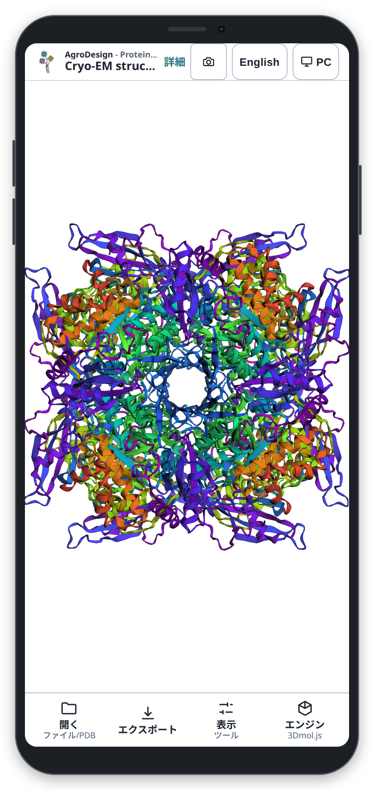
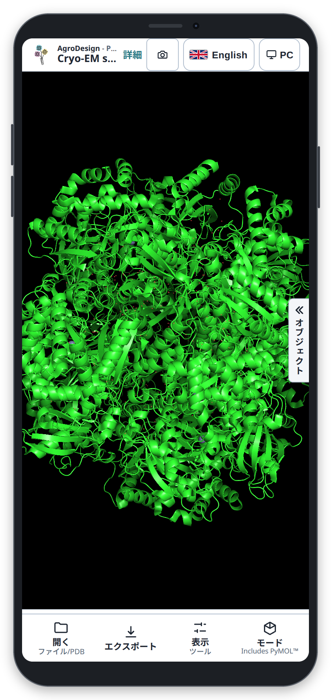
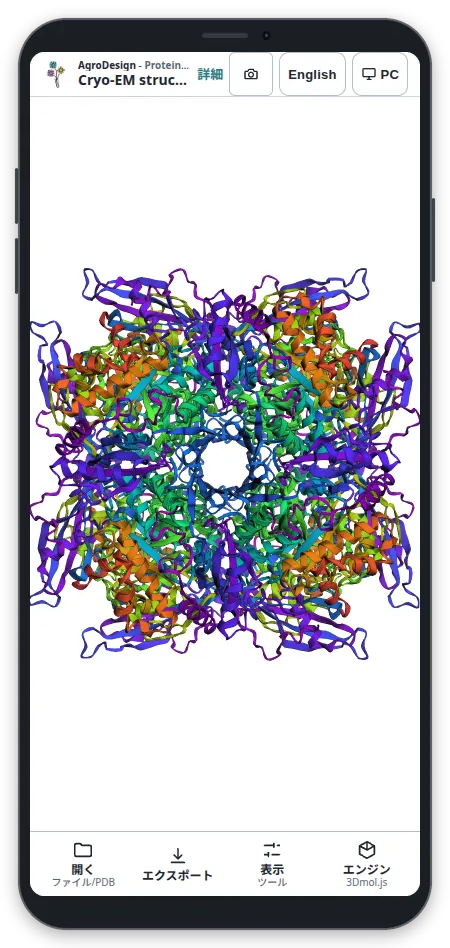
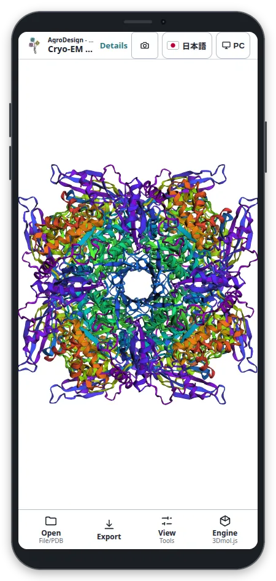
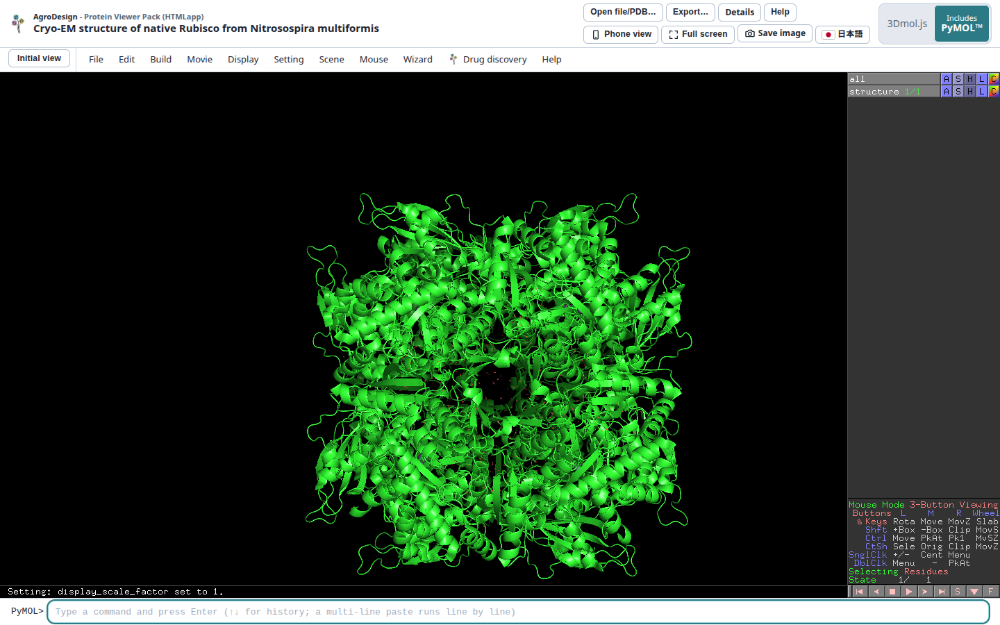

# AgroDesign Protein Viewer Pack (HTMLapp)

*English follows below.*

**タンパク質構造データと複数のビューワーが１ファイルになった**ブラウザアプリです。Includes 3Dmol.js. Includes PyMOL™.

- **HTML ファイル 1 つで動く** — ファイルを開くだけでウェブブラウザ上で動く。インストールもアカウントも不要。
- **オフラインで動く** — ブラウザアプリですが、ネットにつながずに完全に動作します。
- **スマホでも PC でも** — 同じファイルが Windows・macOS・Linux・iPhone / iPad（iOS / iPadOS）・Android™ のブラウザで動きます。
- **メールでアプリと構造を１ファイルで送れる** — 構造を入れたままアプリを保存してメールに添付すれば、受け取った人はダブルクリックですぐに構造を見られます。インストールも、構造生物学の専門知識も要りません。

スマホで見たサンプル 25HN。左: "3Dmol.js" モード、右: フル版の "Includes PyMOL™" モード

PC でも。左: "3Dmol.js" モード、右: "Includes PyMOL™" モード。ワンタッチで切り替えられます。

## 稼働サンプル

- **ブラウザで開く（稼働サンプル）**: <https://agrodesign-studios.github.io/ProteinViewerPack/>

開くと、PDB エントリ [25HN](https://www.rcsb.org/structure/25HN)（Nitrosospira multiformis の Rubisco のクライオ電子顕微鏡構造）を入れたフル版が "3Dmol.js" モードで表示されます。右上のスイッチ（スマホでは下部バーの「モード」）で "Includes PyMOL™" モードに切り替えられます。スマホでもそのまま試せます。最初に約 21 MB を読み込みます。ほかの構造は「ファイル/PDBを開く…」（スマホでは下部バーの「開く」）で開けます。

## ダウンロード

[Releases](https://github.com/AgroDesign-Studios/ProteinViewerPack/releases/latest) からどちらか 1 つをダウンロードし、ダブルクリックで開きます。

| ファイル | 大きさ | 中身 |
|---|---|---|
| `AgroDesign-ProteinViewerPack-v<版>_full_<日付>.html`（フル版） | 約 20 MB | "3Dmol.js" モードと "Includes PyMOL™" モード: "Includes PyMOL™" モードはメニュー・コマンドライン・レイトレース画像・.pse セッション |
| `AgroDesign-ProteinViewerPack-v<版>_light_<日付>.html`（ライト版） | 約 1.4 MB | "3Dmol.js" モードのみ |

ダウンロードしたファイルは空です。「ファイル/PDBを開く…」で構造ファイル（PDB・mmCIF・SDF/MOL・MOL2・XYZ、フル版は .pse も）を開くか、PDB ID を入れるか、ファイルをページにドロップします。

**サンプル**: [`index.html`](index.html)（日本語）と [`en/index.html`](en/index.html)（英語）は、PDB エントリ [25HN](https://www.rcsb.org/structure/25HN) を入れたフル版です。「Download raw file」でダウンロードしてダブルクリックすると開きます。構造ファイルだけなら [`sample/25HN.cif`](sample/25HN.cif)。

## メールで構造を送る

1. 構造を開く
2. 「エクスポート…」→「HTMLappとして出力（このアプリをコピー）」で、「版」（「ライト版」か、フル版にあたる「通常版」）を選んで保存
3. 保存した .html をメールに添付

メールの添付は 20〜25 MB 程度までのことが多く、フル版（約 20 MB＋構造）は届かないことがあります。メールにはライト版（約 1.4 MB＋構造）を使うか、フル版はファイル共有サービスで渡してください。
※注意：iPhone/iPadの場合は、iOSの仕様によりHTMLファイルをそのまま開くことができません。iOSアプリでは、Microsoft EdgeのみHTMLファイルを直接開けることを確認しております。（添付ファイルをクリック→右上(･･･）→共有→EDGEを選択→EDGEで開く）

## 使い方

- **回す・拡大・移動**: マウスは左ドラッグ・右ドラッグ・中ドラッグ。タッチは下の「スマホでの操作」。
- **モードの切り替え（フル版）**: 右上の切り替え（スマホは下部バーの「モード」）で "3Dmol.js" モードと "Includes PyMOL™" モードを切り替えます。"Includes PyMOL™" モードは起動に時間がかかり、メモリを 0.5〜1.5 GB 使います。
- **スマホ表示**: 幅の狭い画面では 1 画面に収まる表示になり、下部バーで操作します。上部の「スマホ表示」／「PC」で切り替えられます。
- **言語**: 日本語で開きます。上部の「English」／「日本語」で切り替えます。
- **HELP**: 「使い方」「最新版ダウンロード」「ライセンス表記」「改良点」。

## できること

- "3Dmol.js" モード: リボン・スティック・ボール＆スティック・ライン・表面、配色、測定、ペンとレーザーポインター、奥行き強調、断面、平行投影
- フル版の "Includes PyMOL™" モード: メニューとコマンドライン、.pse セッション、レイトレース画像
- 保存: スクリーンショット（PNG）、レイトレース画像、構造ファイル、選択範囲の分子ファイル、.pse、VRML（.wrl）、HTMLapp
- 開いたファイルはどこにも送りません。ネットにつなぐのは、PDB から読むとき（files.rcsb.org）、「GitHub の最新版と比べる」を押したとき（api.github.com）、外へのリンクを開いたときだけです。

## スマホでの操作

左: ピンチで拡大・縮小。中: 2 本指でなぞって移動。右: 1 本指で回転。灰色の丸は指の位置です。

- **1 本指でなぞる**: 回転
- **2 本指で広げる・つまむ（ピンチ）**: 拡大・縮小
- **2 本指でなぞる**: 上下左右に移動（"3Dmol.js" モードと "Includes PyMOL™" モードで同じ）
- **3Dmol.js オリジナルの操作**: "3Dmol.js" モードは、3Dmol.js 本来の操作（2 本指は拡大・縮小だけ、3 本指で移動）にも切り替えられます。下部バーの「表示」か HELP の「使い方」の「3Dmol.js オリジナルの操作を使う」で、選んだ操作はこのブラウザが覚えます。
- **下部バーの「表示」**: 拡大・縮小のボタン（"Includes PyMOL™" モードでは全体を表示するボタンも）
- **下部バーの「モード」**: "3Dmol.js" モードと "Includes PyMOL™" モードの切り替え

## PC での表示（スイッチで切替）

 

右上のスイッチで "3Dmol.js" モード（左）と "Includes PyMOL™" モード（右）を切り替えます。

## 動作環境

| ブラウザ | "3Dmol.js" モード（両方の版） | "Includes PyMOL™" モード（フル版） |
|---|---|---|
| Chrome・Edge（Windows・macOS・Linux・Android） | 111 以降 | 111 以降 |
| Firefox（Windows・macOS・Linux・Android） | 121 以降 | 121 以降 |
| Safari（macOS） | 16.4 以降 | 17 以降 |
| iPhone・iPad のブラウザ（Safari・Edge・Chrome など。どれも WebKit） | iOS / iPadOS 16.4 以降 | iOS / iPadOS 17 以降 |

- **実機で確認済み**: Windows の Chrome、iPhone の Edge
- **自動検証のみ**: Linux の Chrome（headless・ソフトウェア描画で両方のビューアを確認）
- **要件上は動くはず（未確認）**: Android（Chrome・Firefox など）、macOS（Safari・Chrome など）、Windows の Edge・Firefox、iPhone の Safari、iPad
- "Includes PyMOL™" モードが使えないブラウザやメモリの少ないスマホでは "3Dmol.js" モードで表示します。WebGL がないブラウザでは、鎖とリガンドの一覧を文字で表示します。

## 改良点

フル版の "Includes PyMOL™" モードは、Open-Source PyMOL 3.2.0a（pymol-open-source のコミット edcda80f）を AgroDesign Studios が変更し、Pyodide 314.0.7 向けに WebAssembly でビルドしたものです。オリジナル版との違いは次のとおりです。

- **入っていないもの**: TrueType のラベル用フォント 14 種のうち、Serif・Mono・Gentium の 10 種（9〜18 番。これらを指定したラベルは DejaVu Sans で描きます。Sans の 4 種は残しています）。Qt・プラグイン・HTTP/RPC サーバー・外部プログラム連携・デモのウィザードなど、ブラウザで動かない部分。メニューの 28 項目
- **起動時の設定の違い**: `trilines`・`cgo_shader_ub_color` をオン、`defer_builds_mode` は表示中の状態だけを作る（グリッドではオリジナル版どおり）、レイトレースは 1 スレッド
- **ブラウザで動かすための変更**: WebGL1/WebGL2 向けのシェーダーの書き換えなど（パッチ 0001〜0005）
- **ファイルを安全に読むための変更**: `.pse` セッションは許可リストで読み、pickle やスクリプトの形式は開きません。ムービーとウィザードはセッションから戻しません
- **起動を速く、ダウンロードを小さく**: 不透明な表面の毎フレームの並べ替えをやめ、近傍リストの作り方を速くしたほか、Python のコンパイル済みファイルの同梱、numpy の遅延展開など。多くは結果を変えません。ビルドのたびに確かめているもの（タブに書いています）と、設計のときに手で確かめたものがあります。不透明な表面の変更では、表面の縁の数画素が変わることがあり、`transparency_global_sort 1` と `pick_surface 1` での動きも変わります。また、コンパイル済みの Python では、標準ライブラリの中のトレースバックの行にソースの文が出ません
- **オリジナル版の修正の取り込み**: UTF-8 のバッファ修正（オリジナル版 #522）

14 個のパッチの全文と、各変更の結果への影響（同じ・見た目が違うことがある・使えない など）は、フル版の HELP の「改良点」タブにあります。3Dmol.js 2.5.5 は改変せずに使っています。アプリがその周りに加えたもの（2 本指の移動など）は、どちらの版でも同じタブに挙げています。

## 引用

このアプリを使った研究を発表するときは、使ったビューアを、それぞれの作者・会社が求める形で引用してください（引用文は英語の原文のまま）。

- 3Dmol.js（"3Dmol.js" モード。フル版・ライト版とも）— 3Dmol.js の作者が求める論文:
  Nicholas Rego and David Koes, "3Dmol.js: molecular visualization with WebGL", *Bioinformatics* 31(8):1322–1324 (2015), [doi:10.1093/bioinformatics/btu829](https://doi.org/10.1093/bioinformatics/btu829)
- フル版の "Includes PyMOL™" モード：Built using PyMOL™. Schrödinger, LLC が求める形で、使った版を入れて:
  The PyMOL Molecular Graphics System, Version 3.2, Schrödinger, LLC.

## ライセンス・帰属・商標

- このアプリ自体は [MIT License](LICENSE)。同梱のオープンソースソフトウェアはそれぞれのライセンスに従い、名前・版・全文は [`NOTICE`](NOTICE) とアプリの「HELP」→「ライセンス表記」にあります。
- Includes PyMOL™.（PyMOL™ を含みます。）フル版の "Includes PyMOL™" モードは、AgroDesign Studios が Open-Source PyMOL のソースコードをそのライセンスのもとで変更・機能追加し、WebAssembly でブラウザ向けにビルドしたものです。Schrödinger, LLC が配布する PyMOL 製品とは別のものです。
- Includes 3Dmol.js（BSD 3-Clause License）。論文の引用は上の「引用」の節にあります。
- サンプルは RCSB PDB のエントリ 25HN（[DOI 10.2210/pdb25HN/pdb](https://doi.org/10.2210/pdb25HN/pdb)）。PDB のデータは CC0 1.0 です。
- バッジとスマホ・モニターの絵（[`images/`](images)）:
  - Android のロボットは Google の作品を複製・改変したもので、CC BY 3.0 の条件に従って使用しています（原文: "The Android robot is reproduced or modified from work created and shared by Google and used according to terms described in the [Creative Commons](https://creativecommons.org/licenses/by/3.0/) 3.0 Attribution License."）。
  - Linux のペンギン（Tux）は Larry Ewing（lewing@isc.tamu.edu）が The GIMP で描いたもので、[Simple Icons](https://simpleicons.org/) の図形（CC0 1.0）を使っています。
  - iOS / iPadOS のバッジの電話の絵と、スクリーンショットを囲むスマホとモニターの絵は、このリポジトリで描いたもので、特定の製品を表すものではありません。ほかの OS とブラウザは名前だけで示しています。
  - 「スマホでの操作」のアニメーションは、このアプリの実際の画面を録画し、指の位置の丸を描き足したものです。
- 商標: Android と Chrome は Google LLC の商標です。iPhone、iPad、iPadOS、macOS、Safari は、米国およびその他の国や地域で登録された Apple Inc. の商標です。IOS は Cisco の米国およびその他の国における商標または登録商標で、ライセンスに基づき使用されています。Microsoft、Microsoft Edge、Windows は Microsoft グループ各社の商標です。Linux® は Linus Torvalds の米国およびその他の国における登録商標です。Firefox は Mozilla Foundation の米国およびその他の国における商標です。このアプリはこれらの会社・団体（Mozilla を含む）と公式な関係はなく、名前は動作する環境を示すためだけに使っています。
- 製作: 株式会社アグロデザイン・スタジオ（AgroDesign Studios）、西ヶ谷有輝（NISHIGAYA Yuki）。Copyright (c) 2026 AgroDesign Studios
- PyMOL は Schrödinger, LLC の商標です（原文はこの README の末尾）。

---

# AgroDesign Protein Viewer Pack (HTMLapp) (English)

A protein structure viewer in **one HTML file**. Includes 3Dmol.js. Includes PyMOL™.

- **One HTML file** — double-click it and it opens in your browser. Nothing to install, no account, works offline.
- **On phones and PCs** — the same file runs in the browser on Windows, macOS, Linux, iPhone / iPad (iOS / iPadOS) and Android™.
- **Send a structure by e-mail** — save the app with your structure inside and attach it. The recipient double-clicks it and sees the structure at once: no install, no structural-biology expertise.

The sample 25HN on a phone. Left: "3Dmol.js" mode. Right: the full edition's "Includes PyMOL™" mode.

On a PC too. Left: "3Dmol.js" mode. Right: "Includes PyMOL™" mode. One click switches between them.

## Live sample

- **Open in the browser (live sample)**: <https://agrodesign-studios.github.io/ProteinViewerPack/en/>

It opens the full edition with PDB entry [25HN](https://www.rcsb.org/structure/25HN) (a cryo-EM structure of Rubisco from Nitrosospira multiformis) in "3Dmol.js" mode. The switch at the top right (on a phone, "Mode" in the bottom bar) changes to "Includes PyMOL™" mode. It works on a phone as well. The page loads about 21 MB the first time. Open other structures with "Open file/PDB…" (on a phone, "Open" in the bottom bar).

## Download

From [Releases](https://github.com/AgroDesign-Studios/ProteinViewerPack/releases/latest), download one file and double-click it.

| File | Size | Contents |
|---|---|---|
| `AgroDesign-ProteinViewerPack-v<version>_full_<date>.html` (full edition) | about 20 MB | "3Dmol.js" mode and "Includes PyMOL™" mode: "Includes PyMOL™" mode has menus, a command line, ray-traced images and .pse sessions |
| `AgroDesign-ProteinViewerPack-v<version>_light_<date>.html` (light edition) | about 1.4 MB | "3Dmol.js" mode only |

The downloaded files are empty. Open a structure file with "Open file/PDB…" (PDB, mmCIF, SDF/MOL, MOL2, XYZ; .pse in the full edition), enter a PDB ID, or drop a file on the page.

**Sample**: [`index.html`](index.html) (Japanese) and [`en/index.html`](en/index.html) (English) are the full edition with PDB entry [25HN](https://www.rcsb.org/structure/25HN) inside. Download one ("Download raw file") and double-click it. The structure file alone: [`sample/25HN.cif`](sample/25HN.cif).

## Sending a structure by e-mail

1. Open the structure
2. "Export…" → "Save as HTMLapp (a copy of this app)", choose the edition and save
3. Attach the saved .html to an e-mail

Mail services often cap attachments at about 20-25 MB, so the full edition (about 20 MB plus the structure) may not get through. Send the light edition (about 1.4 MB plus the structure), or share the full edition through a file-sharing service.

## How to use

- **Turn, zoom, move**: mouse left, right and middle drag; on a touch screen see "On a phone" below.
- **Switch mode (full edition)**: the control at the top right (on a phone, "Mode" in the bottom bar) switches between "3Dmol.js" mode and "Includes PyMOL™" mode. "Includes PyMOL™" mode takes a while to start and uses 0.5-1.5 GB of memory.
- **Phone layout**: a narrow screen gets a one-screen layout with a bottom bar. "Phone view" / "PC" at the top switches.
- **Language**: opens in Japanese; "English" / "日本語" at the top switches.
- **Help**: "How to use", "Latest version", "Licences", "Code changes".

## Features

- "3Dmol.js" mode: ribbon, stick, ball and stick, line, surface; colouring; measuring; pen and laser pointer; depth cueing, slicing, orthographic view
- The full edition's "Includes PyMOL™" mode: menus and command line, .pse sessions, ray-traced images
- Save: screenshots (PNG), ray-traced images, structure files, molecule files of a selection, .pse, VRML (.wrl), HTMLapp
- The files you open are sent nowhere. The app goes online only to load from the PDB (files.rcsb.org), when you press "Compare with the latest on GitHub" (api.github.com), or when you follow a link out of the file.

## On a phone

Left: pinch to zoom. Middle: drag with two fingers to move. Right: drag with one finger to turn. The grey circles show where the fingers are.

- **Drag with one finger**: turn
- **Spread or pinch two fingers**: zoom in or out
- **Drag with two fingers**: move up, down and sideways (the same in "3Dmol.js" mode and "Includes PyMOL™" mode)
- **The original 3Dmol.js controls**: "3Dmol.js" mode can use 3Dmol.js's own controls instead (two fingers only zoom, three fingers move): "Use the original 3Dmol.js controls" under "View" in the bottom bar or in Help > "How to use". This browser remembers the choice.
- **"View" in the bottom bar**: buttons to zoom in and out (and, in "Includes PyMOL™" mode, to show everything)
- **"Mode" in the bottom bar**: switch between "3Dmol.js" mode and "Includes PyMOL™" mode

## On a PC (one switch changes the viewer)

 

The switch at the top right changes between "3Dmol.js" mode (left) and "Includes PyMOL™" mode (right).

## Supported environments

| Browser | "3Dmol.js" mode (both editions) | "Includes PyMOL™" mode (full edition) |
|---|---|---|
| Chrome, Edge (Windows, macOS, Linux, Android) | 111 or later | 111 or later |
| Firefox (Windows, macOS, Linux, Android) | 121 or later | 121 or later |
| Safari (macOS) | 16.4 or later | 17 or later |
| Browsers on an iPhone or iPad (Safari, Edge, Chrome and others, all WebKit) | iOS / iPadOS 16.4 or later | iOS / iPadOS 17 or later |

- **Tried on real devices**: Chrome on Windows, Edge on an iPhone
- **Automated check only**: Chrome on Linux (headless, software rendering, both viewers)
- **Should work from the requirements (not yet tried)**: Android (Chrome, Firefox and others), macOS (Safari, Chrome and others), Edge and Firefox on Windows, Safari on an iPhone, an iPad
- Where "Includes PyMOL™" mode cannot run (an older browser, a phone short of memory), "3Dmol.js" mode shows the structure. Without WebGL, the app lists the chains and ligands in words.

## Code changes

The full edition's "Includes PyMOL™" mode is Open-Source PyMOL 3.2.0a (pymol-open-source commit edcda80f), modified by AgroDesign Studios and compiled to WebAssembly for Pyodide 314.0.7. It differs from upstream as follows.

- **Left out**: ten of the 14 TrueType label fonts, Serif, Mono and Gentium (ids 9–18; labels set to them are drawn in DejaVu Sans, and the four Sans faces stay); Qt, plugins, the HTTP/RPC servers, external-program bindings, the demo wizards and the other parts that cannot run in a browser; 28 menu entries
- **Start-up settings that differ**: `trilines` and `cgo_shader_ub_color` on, `defer_builds_mode` builds only the state on screen (as upstream in grid views), one ray-tracing thread
- **Changes to run in a browser**: shaders rewritten for WebGL1/WebGL2 and related fixes (patches 0001-0005)
- **Safer reading of files**: `.pse` sessions are read through an allow-list, pickle and script formats are refused, and a session's movie and wizard are not restored
- **Faster start-up, smaller download**: opaque surfaces are no longer re-sorted every frame, faster neighbour lists, precompiled Python, numpy unpacked on first use, among others. Most leave results unchanged; some are checked at every build (the tab marks them), others were checked by hand during the design work. The opaque-surface change can alter a few pixels at surface edges and changes how `transparency_global_sort 1` and `pick_surface 1` behave; with precompiled Python a traceback line inside the standard library shows no source text
- **Fixes taken from upstream**: the UTF-8 buffer fix (upstream #522)

In the full edition, Help > "Code changes" has all 14 patches in full and each change's effect on results (unchanged, the picture can differ, not available, ...). 3Dmol.js 2.5.5 is used unmodified; in both editions the same tab lists what the app adds around it (two-finger move and others).

## Citation

If you publish work that used this app, please cite the viewer you used, in the form its makers ask for (the citations are given word for word).

- 3Dmol.js ("3Dmol.js" mode, in both editions): the paper the 3Dmol.js authors ask users to cite:
  Nicholas Rego and David Koes, "3Dmol.js: molecular visualization with WebGL", *Bioinformatics* 31(8):1322-1324 (2015), [doi:10.1093/bioinformatics/btu829](https://doi.org/10.1093/bioinformatics/btu829)
- The full edition's "Includes PyMOL™" mode: Built using PyMOL™. In the form Schrödinger, LLC asks for, with the version used:
  The PyMOL Molecular Graphics System, Version 3.2, Schrödinger, LLC.

## License, attribution and trademarks

- This app is under the [MIT License](LICENSE). The open-source software it carries keeps its own licence; names, versions and full texts are in [`NOTICE`](NOTICE) and in the app under "Help" → "Licences".
- Includes PyMOL™. The full edition's "Includes PyMOL™" mode is built from Open-Source PyMOL source code, which AgroDesign Studios modified and extended under its license and compiled for the browser with WebAssembly. It is distinct from the PyMOL products distributed by Schrödinger, LLC.
- Includes 3Dmol.js (BSD 3-Clause License). Its paper is under "Citation" above.
- The sample is PDB entry 25HN from the RCSB PDB ([DOI 10.2210/pdb25HN/pdb](https://doi.org/10.2210/pdb25HN/pdb)). PDB data are CC0 1.0.
- Badges, phone and monitor pictures ([`images/`](images)):
  - The Android robot is reproduced or modified from work created and shared by Google and used according to terms described in the [Creative Commons](https://creativecommons.org/licenses/by/3.0/) 3.0 Attribution License.
  - Tux, the Linux penguin, was drawn by Larry Ewing (lewing@isc.tamu.edu) with The GIMP; the shape used is from [Simple Icons](https://simpleicons.org/) (CC0 1.0).
  - The phone outline on the iOS / iPadOS badge and the phone and the monitor around the screenshots were drawn for this repository and depict no particular product. The other systems and the browsers are shown by name only.
  - The animations under "On a phone" are recordings of this app's own screen, with circles drawn where the fingers are.
- Trademarks: Android and Chrome are trademarks of Google LLC. iPhone, iPad, iPadOS, macOS and Safari are trademarks of Apple Inc., registered in the U.S. and other countries and regions. IOS is a trademark or registered trademark of Cisco in the U.S. and other countries and is used under license. Microsoft, Microsoft Edge and Windows are trademarks of the Microsoft group of companies. Linux® is the registered trademark of Linus Torvalds in the U.S. and other countries. Firefox is a trademark of the Mozilla Foundation in the U.S. and other countries. This app is not officially associated with any of these companies or organisations, Mozilla included; the names are used only to say where the app runs.
- Made by AgroDesign Studios, Inc. (NISHIGAYA Yuki). Copyright (c) 2026 AgroDesign Studios
- The PyMOL trademark notice is at the end of this README.

---

## 更新履歴

各バージョンの主な変更です。ダウンロードは [Releases](https://github.com/AgroDesign-Studios/ProteinViewerPack/releases) から。

### v1.0.0（2026-11-19）
- 最初の版です。

---

## Release notes

The main changes in each version. Downloads are on the [Releases](https://github.com/AgroDesign-Studios/ProteinViewerPack/releases) page.

### v1.0.0 (2026-11-19)
- First version.

---

PyMOL is a trademark of Schrodinger, LLC.
